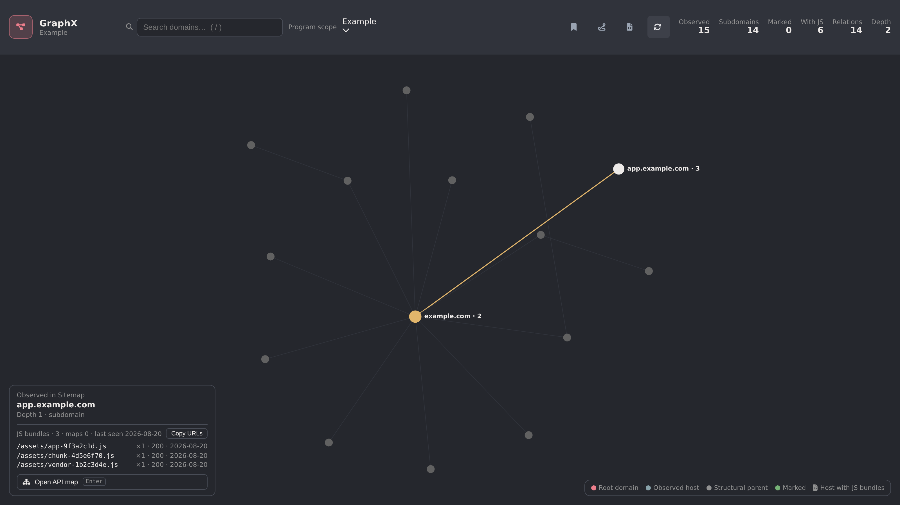

# GraphX

GraphX is a native Caido extension for exploring relationships in project data. It renders an interactive, full-page graph of every observed Sitemap domain that matches a selected Caido scope, with persistent domain marks, connection-path highlighting, and per-host JavaScript asset association.



## Features at a glance

- **Scope-wide domain graph** — every Sitemap domain in scope, laid out force-directed, with structural parent chains (`example.com` → `api.example.com`).
- **Persistent marks** — flag interesting domains (with or without their subdomain subtrees); marks survive restarts per project.
- **Connection paths** — highlight the full path between marked domains to see how surface connects.
- **JS asset awareness** — per-host bundle and source-map inventory from observed traffic, with first/last-seen timestamps.
- **API map drill-down** — a Swagger-like route map per host, built sitemap-first from your own traffic, with captured request samples for each route.
- **Search and keyboard-first navigation** — `/` or `Ctrl/Cmd+K` to jump to any domain.
- **Agent API** — GET + JSON on `127.0.0.1:8771` so automation can query the estate model.
- **On-demand JS recon** — passively scans all observed JavaScript bodies and source maps, retaining a source location for each lead; explicitly opting in for one scan attempts every missing in-scope referenced map by default, with rate control and an optional request cap.

## Current behavior

- Reads domain roots from Caido's local Sitemap API for the selected scope.
- Reapplies the scope allowlist and denylist before creating graph nodes.
- Normalizes and deduplicates hostnames.
- Creates immediate DNS-suffix relationships such as `example.com` → `stage.example.com` → `api.stage.example.com`.
- Adds a missing suffix only when that structural parent is itself in scope.
- Renders an Obsidian-style layout with Graphology and a ForceAtlas2 worker. It uses Sigma when WebGL is available and an interactive Canvas 2D renderer otherwise.
- Mirrors Caido's active light or dark mode across the page, controls, graph palette, and renderer without requiring a reload.
- Counts Sitemap events as pending changes on the Sync badge; those events do not rebuild the graph, and there is no periodic reconciliation.
- Refreshes on manual Sync, page entry, and project or scope changes without retaining data from the previous project.
- Stops subscriptions, timers, layout workers, and rendering when the operator leaves GraphX, then resumes from a fresh project snapshot on return.
- Marks domains — alone or with their whole subdomain subtree — from a right-click context menu or the keyboard (`M` / `Shift+M`). Marks persist per Caido project in the plugin's SQLite database and render in a distinct marker color.
- Isolates marked domains with their ancestor chains via the **Marked only** toolbar toggle.
- Highlights the connection path between marked domains — the union of their ancestor chains, which is the unique minimal connector in this parent-domain forest — via the **Connection paths** toolbar toggle, muting everything else.
- Associates observed JavaScript bundles and source maps with each domain from local HTTP traffic (HTTPQL `req.path.like` sweep, grouped per host). The **JS assets** toggle mutes hosts without bundles and suffixes bundle counts onto labels; selecting a host lists its bundles with status, request count, map pairing, and a copy-URLs action.
- Searches domains and subdomains from the toolbar (`/` or `Ctrl/Cmd+K` to focus): ranked exact/prefix/substring matches in a live dropdown, and picking one selects the node and centers the camera on it.
- Drills into any domain's API map: `Enter` (or **Open API map**) swaps the canvas to a tree-laid-out route map of that host — segment trie with status-colored endpoints sized by traffic — from the same sitemap-first pipeline as the agent API's `/api-map`. `← Domains` or `Escape` returns.
- Locates sampled route requests and captured JS sources in Caido HTTP History, or opens an unsent Replay draft from the captured request ID. Sitemap-only routes and actively fetched maps have no captured request to open.

An “observed host” means a domain root exists in the Caido Sitemap. A “structural parent” is an in-scope suffix derived only to preserve the relationship chain. Neither state currently means DNS-resolved or DNS-unresolved.

## Use in Caido

Install `dist/plugin_package.zip` from Caido's Plugins page, then select **GraphX** in the sidebar and choose a program scope. The graph always displays the complete scope at every depth. Use the toolbar search box (`/` or `Ctrl/Cmd+K`) to find any domain and jump to it. Drag nodes to pin the working layout, pan or zoom the canvas, and select a node to isolate its immediate neighborhood. Right-click the selected node (or press `M`; `Shift+M` includes its subdomains) to mark it — marks persist across restarts within the current project. The bookmark toolbar toggle shows only marked domains and their parent chains; the route toggle highlights the full connection path between marked domains; the file-code toggle fades hosts without observed JavaScript bundles and combines with the bookmark toggle into a joint emphasis. The graph is keyboard-focusable: use the arrow keys, Home/End, Escape, and `0` (fit view).

Domain search and keyboard jumps center the selected host without resetting
the current zoom.

Route details show up to eight representative captured requests (one per method/status combination). **History** locates the original request row; **Replay** creates and opens a draft without sending it. JS recon shows an asset or original source-map module and a 1-based line and column for each deduplicated lead, with the same pivots when a captured request exists.

Inside the API map, the toolbar searches route templates and concrete example
paths instead of domains. Use `/` or `Ctrl/Cmd+K`, type a path, then choose
from up to 25 suggestions with the arrow keys and `Enter` (or click one).
The map centers the endpoint and opens its details. `Escape` in the search
clears the query without leaving the map; searching sends no target requests.

Use **Refresh API map** in the drill-down to reread that host's captured
routes. **Sync domain graph** invalidates all cached API maps and refreshes
the open map too. Both controls use local Caido data without sending target
traffic.

In API route details, each captured sample's **Copy URL** preserves its
scheme, non-default port, concrete path, and query string. **Copy route template**
copies only the relative template (for example, `/api/users/{id}`). Samples
without a known origin and sitemap-only routes never receive invented URLs.

In the per-host JS asset panel, **Copy URLs** copies each distinct captured
bundle URL with its scheme, non-default port, and query string; different
captures of the same path remain separate URLs. No HTTPS origin is assumed.

The JS asset list shows 50 bundles per page. **Show next** and **Previous**
reach every discovered bundle without rendering them all at once. **Copy URLs**
still includes bundles on every page.

Expand a JS bundle to see its captured URL variants. **History** locates the
specific request row in Caido (select it to inspect its response); **Replay**
opens an unsent draft. If a URL has a newer `304` revalidation, the pivot
prefers an earlier successful response.

**Copy endpoints** preserves each captured asset's scheme and port; the same
relative path can yield multiple distinct URLs. Leads with no known origin
remain relative rather than being rewritten to HTTPS.

Captured script discovery also recognizes `text/javascript` and
`application/javascript` response headers on paths without `.js`/`.mjs`,
including extensionless URLs. MIME text in a response body does not make it
a script; `.map` remains a map. Both the asset list and passive recon use
Caido's captured responses, without extra target requests.

JS recon reads captured traffic by default. It follows captured HTTP
`SourceMap` headers (case-insensitive), including bundles without a footer;
those headers take precedence over a `//# sourceMappingURL=` footer. Captured
maps are parsed without a target request. A captured `304` revalidation does
not hide an earlier `200` JS or source-map body at the same URL. To request
missing source maps from a target, check **Enable active source-map fetch** for
that scan. Active scans attempt every discovered in-scope missing map by
default (which can take time); optionally enable a 1–20 request limit. Sends
are spaced by at least 1,000 ms
(default 2,000 ms). The consent and optional limit reset after each attempt.
The panel shows how many missing references were discovered; failed responses
and out-of-scope URLs may still remain unfetched. Every active attempt is
audited per project in SQLite.

## Agent API

The backend plugin serves a GET + JSON API on `127.0.0.1:8771` (loopback only, no auth). `GET /js-recon` scans only locally captured responses and saves findings; it never sends target traffic. Active source-map fetching is available only through the explicit GraphX UI controls, not through this unauthenticated API. The audit endpoint lists recent active recon events for the selected project, scope, and host:

```bash
curl -s 127.0.0.1:8771/health                  # liveness + version
curl -s 127.0.0.1:8771/marks                   # project + marked hosts
curl -s "127.0.0.1:8771/domains?scope=Example" # full domain graph JSON
curl -s "127.0.0.1:8771/assets?scope=Example"  # per-host JS bundle/map groupings
curl -s "127.0.0.1:8771/brief?scope=Example"   # composite estate brief (session start)
curl -s "127.0.0.1:8771/api-map?host=api.example.com"  # per-host route map (Swagger-like templates)
curl -s "127.0.0.1:8771/js-recon?host=app.example.com"       # passive JS scan; no target requests
curl -s "127.0.0.1:8771/js-recon/audit?host=app.example.com" # recent active-scan audit events
```

`?scope=` takes a scope id or name and may be omitted when only one scope exists. All routes are GET + JSON; errors are `{ "error": string }`. See `docs/features/GX-DOM-007.md` and `docs/features/GX-DOM-010.md`.

## Development

The reproducible toolchain is pinned in `mise.toml`.

```bash
pnpm install --frozen-lockfile
pnpm typecheck
pnpm lint
pnpm knip
pnpm test
pnpm build
```

The workspace is split into three packages:

- `packages/shared`: pure scope, normalization, graph-domain types, and typed plugin contracts.
- `packages/backend`: Caido project context and project lifecycle events.
- `packages/frontend`: Caido adapters, orchestration composables, Vue components, and the replaceable graph renderer.

See `docs/architecture.md`, `docs/features/GX-DOM-001.md`, and `docs/features/GX-DOM-002.md` for the architecture and acceptance contracts.
